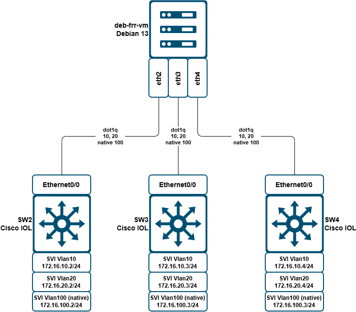
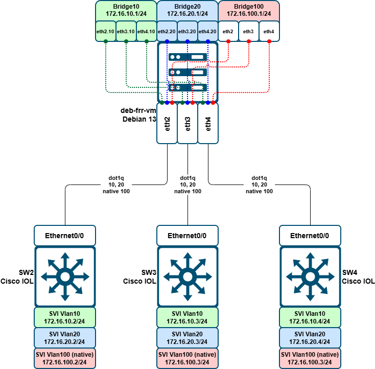
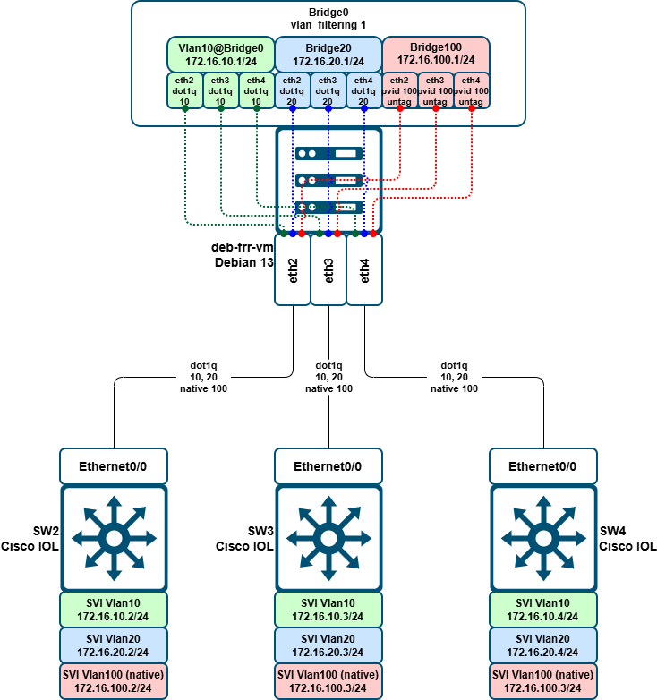

# Linux bridge config

## Содержание

- [Linux bridge config](#linux-bridge-config)
  - [Содержание](#содержание)
  - [Базовая топология](#базовая-топология)
  - [Bridge per vlan](#bridge-per-vlan)
    - [Bridge per vlan - топология](#bridge-per-vlan---топология)
    - [Bridge per vlan - базовая конфигурация](#bridge-per-vlan---базовая-конфигурация)
    - [Bridge per vlan - настройка и проверка](#bridge-per-vlan---настройка-и-проверка)
  - [Single bridge with multiple vlans](#single-bridge-with-multiple-vlans)
    - [Single bridge with multiple vlans - топология](#single-bridge-with-multiple-vlans---топология)
    - [Single bridge with multiple vlans - базовая конфигурация](#single-bridge-with-multiple-vlans---базовая-конфигурация)
    - [Single bridge with multiple vlans - настройка и проверка](#single-bridge-with-multiple-vlans---настройка-и-проверка)
  - [Список использованных команд](#список-использованных-команд)
  - [Настройка bridge через /etc/network/interfaces](#настройка-bridge-через-etcnetworkinterfaces)

## Базовая топология



## Bridge per vlan

### Bridge per vlan - топология



### Bridge per vlan - базовая конфигурация

**SW-2:**

```cisco
vlan 10,20,100
!
no spanning-tree vlan 1-4094
!
interface Ethernet0/0
 switchport trunk encapsulation dot1q
 switchport trunk native vlan 100
 switchport trunk allowed vlan 10,20,100
 switchport mode trunk
!
interface Vlan10
 mac-address 0000.0010.0002
 ip address 172.16.10.2 255.255.255.0
!
interface Vlan20
 mac-address 0000.0020.0002
 ip address 172.16.20.2 255.255.255.0
!
interface Vlan100
 mac-address 0000.0100.0002
 ip address 172.16.100.2 255.255.255.0
!
```

**SW-3:**

```cisco
vlan 10,20,100
!
no spanning-tree vlan 1-4094
!
interface Ethernet0/0
 switchport trunk encapsulation dot1q
 switchport trunk native vlan 100
 switchport trunk allowed vlan 10,20,100
 switchport mode trunk
!
interface Vlan10
 mac-address 0000.0010.0003
 ip address 172.16.10.3 255.255.255.0
!
interface Vlan20
 mac-address 0000.0020.0003
 ip address 172.16.20.3 255.255.255.0
!
interface Vlan100
 mac-address 0000.0100.0003
 ip address 172.16.100.3 255.255.255.0
!
```

**SW-4:**

```cisco
vlan 10,20,100
!
no spanning-tree vlan 1-4094
!
interface Ethernet0/0
 switchport trunk encapsulation dot1q
 switchport trunk native vlan 100
 switchport trunk allowed vlan 10,20,100
 switchport mode trunk
!
interface Vlan10
 mac-address 0000.0010.0004
 ip address 172.16.10.4 255.255.255.0
!
interface Vlan20
 mac-address 0000.0020.0004
 ip address 172.16.20.4 255.255.255.0
!
interface Vlan100
 mac-address 0000.0100.0004
 ip address 172.16.100.4 255.255.255.0
!
```

### Bridge per vlan - настройка и проверка

Исходное состояние:

**VM-1:**

```bash
[2026-11-22 18:39:14] root@deb-frr-vm:~# ip -br link show
lo               UNKNOWN        00:00:00:00:00:00 <LOOPBACK,UP,LOWER_UP>
eth0             UP             50:06:01:00:46:00 <BROADCAST,MULTICAST,UP,LOWER_UP>
eth1             DOWN           50:06:01:00:46:01 <NO-CARRIER,BROADCAST,MULTICAST,UP>
eth2             UP             50:06:01:00:46:02 <BROADCAST,MULTICAST,UP,LOWER_UP>
eth3             UP             50:06:01:00:46:03 <BROADCAST,MULTICAST,UP,LOWER_UP>
eth4             UP             50:06:01:00:46:04 <BROADCAST,MULTICAST,UP,LOWER_UP>
pimreg@NONE      UNKNOWN        <NOARP,UP,LOWER_UP>
pim6reg@NONE     UNKNOWN        <NOARP,UP,LOWER_UP>
eth2.10@eth2     UP             50:06:01:00:46:02 <BROADCAST,MULTICAST,UP,LOWER_UP>
eth2.20@eth2     UP             50:06:01:00:46:02 <BROADCAST,MULTICAST,UP,LOWER_UP>
eth3.10@eth3     UP             50:06:01:00:46:03 <BROADCAST,MULTICAST,UP,LOWER_UP>
eth3.20@eth3     UP             50:06:01:00:46:03 <BROADCAST,MULTICAST,UP,LOWER_UP>
eth4.10@eth4     UP             50:06:01:00:46:04 <BROADCAST,MULTICAST,UP,LOWER_UP>
eth4.20@eth4     UP             50:06:01:00:46:04 <BROADCAST,MULTICAST,UP,LOWER_UP>
[2026-11-22 18:39:21] root@deb-frr-vm:~#
```

Создаем bridge:

```bash
ip link add $BRIDGE_NAME type bridge
```

```bash
[2026-11-22 18:39:36] root@deb-frr-vm:~# ip link add Bridge10 type bridge
[2026-11-22 18:39:44] root@deb-frr-vm:~# ip link add Bridge20 type bridge
[2026-11-22 18:39:48] root@deb-frr-vm:~# ip link add Bridge100 type bridge
```

Задание MAC-адреса интерфейсу bridge:

```bash
ip link set dev $BRIDGE_NAME address XX:XX:XX:XX:XX:XX
```

**VM-1:**

```bash
[2026-11-22 18:39:51] root@deb-frr-vm:~# ip link set dev Bridge10 address 00:00:00:10:00:01
[2026-11-22 18:40:14] root@deb-frr-vm:~# ip link set dev Bridge20 address 00:00:00:20:00:01
[2026-11-22 18:40:20] root@deb-frr-vm:~# ip link set dev Bridge100 address 00:00:01:00:00:01
[2026-11-22 18:40:28] root@deb-frr-vm:~# ip -br link show | grep Bridge
Bridge10         DOWN           00:00:00:10:00:01 <BROADCAST,MULTICAST>
Bridge20         DOWN           00:00:00:20:00:01 <BROADCAST,MULTICAST>
Bridge100        DOWN           00:00:01:00:00:01 <BROADCAST,MULTICAST>
[2026-11-22 18:41:02] root@deb-frr-vm:~#
```

Включение bridge:

```bash
ip link set dev $BRIDGE_NAME up
```

```bash
[2026-11-22 18:41:02] root@deb-frr-vm:~# ip link set dev Bridge10 up
[2026-11-22 18:41:17] root@deb-frr-vm:~# ip link set dev Bridge20 up
[2026-11-22 18:41:19] root@deb-frr-vm:~# ip link set dev Bridge100 up
[2026-11-22 18:41:21] root@deb-frr-vm:~# ip -br link show | grep Bridge
Bridge10         DOWN           00:00:00:10:00:01 <NO-CARRIER,BROADCAST,MULTICAST,UP>
Bridge20         DOWN           00:00:00:20:00:01 <NO-CARRIER,BROADCAST,MULTICAST,UP>
Bridge100        DOWN           00:00:01:00:00:01 <NO-CARRIER,BROADCAST,MULTICAST,UP>
[2026-11-22 18:41:26] root@deb-frr-vm:~#
```

Интерфейсы bridge ожидаемо остались в DOWN, т.к. в них нет ни одного активного интерфейса.

Добавление интерфейса в bridge:

```bash
ip link set dev $INTF_NAME master $BRIDGE_NAME
```

```bash
[2026-11-22 18:41:38] root@deb-frr-vm:~# ip link set dev eth2.10 master Bridge10
[2026-11-22 18:41:48] root@deb-frr-vm:~# ip link set dev eth3.10 master Bridge10
[2026-11-22 18:41:54] root@deb-frr-vm:~# ip link set dev eth4.10 master Bridge10
[2026-11-22 18:41:57] root@deb-frr-vm:~#
[2026-11-22 18:41:57] root@deb-frr-vm:~# ip link set dev eth2.20 master Bridge20
[2026-11-22 18:42:02] root@deb-frr-vm:~# ip link set dev eth3.20 master Bridge20
[2026-11-22 18:42:05] root@deb-frr-vm:~# ip link set dev eth4.20 master Bridge20
[2026-11-22 18:42:08] root@deb-frr-vm:~#
[2026-11-22 18:42:15] root@deb-frr-vm:~# ip link set dev eth2 master Bridge100
[2026-11-22 18:42:22] root@deb-frr-vm:~# ip link set dev eth3 master Bridge100
[2026-11-22 18:42:24] root@deb-frr-vm:~# ip link set dev eth4 master Bridge100
[2026-11-22 18:42:26] root@deb-frr-vm:~#
[2026-11-22 18:42:35] root@deb-frr-vm:~# ip -br link show | grep Bridge
Bridge10         UP             00:00:00:10:00:01 <BROADCAST,MULTICAST,UP,LOWER_UP>
Bridge20         UP             00:00:00:20:00:01 <BROADCAST,MULTICAST,UP,LOWER_UP>
Bridge100        UP             00:00:01:00:00:01 <BROADCAST,MULTICAST,UP,LOWER_UP>
[2026-11-22 18:42:36] root@deb-frr-vm:~#

```

Проверка связности между SW-устройствами:

**SW2:**

```cisco
SW2#tclsh
SW2(tcl)#foreach IP {
+>172.16.10.3
+>172.16.20.3
+>172.16.100.3
+>172.16.10.4
+>172.16.20.4
+>172.16.100.4
+>} { ping $IP repeat 2 timeout 1 }
Type escape sequence to abort.
Sending 2, 100-byte ICMP Echos to 172.16.10.3, timeout is 1 seconds:
.!
Success rate is 50 percent (1/2), round-trip min/avg/max = 1/1/1 ms
Type escape sequence to abort.
Sending 2, 100-byte ICMP Echos to 172.16.20.3, timeout is 1 seconds:
.!
Success rate is 50 percent (1/2), round-trip min/avg/max = 2/2/2 ms
Type escape sequence to abort.
Sending 2, 100-byte ICMP Echos to 172.16.100.3, timeout is 1 seconds:
.!
Success rate is 50 percent (1/2), round-trip min/avg/max = 1/1/1 ms
Type escape sequence to abort.
Sending 2, 100-byte ICMP Echos to 172.16.10.4, timeout is 1 seconds:
.!
Success rate is 50 percent (1/2), round-trip min/avg/max = 2/2/2 ms
Type escape sequence to abort.
Sending 2, 100-byte ICMP Echos to 172.16.20.4, timeout is 1 seconds:
.!
Success rate is 50 percent (1/2), round-trip min/avg/max = 1/1/1 ms
Type escape sequence to abort.
Sending 2, 100-byte ICMP Echos to 172.16.100.4, timeout is 1 seconds:
.!
Success rate is 50 percent (1/2), round-trip min/avg/max = 1/1/1 ms
SW2(tcl)#
```

Проверка интерфейсов, входящий в bridge:

```bash
ip link show master $BRIDGE_NAME
bridge link show
```

**VM-1:**

```bash
[2026-11-22 18:44:44] root@deb-frr-vm:~# bridge link show
4: eth2: <BROADCAST,MULTICAST,UP,LOWER_UP> mtu 1500 master Bridge100 state forwarding priority 32 cost 100
5: eth3: <BROADCAST,MULTICAST,UP,LOWER_UP> mtu 1500 master Bridge100 state forwarding priority 32 cost 100
6: eth4: <BROADCAST,MULTICAST,UP,LOWER_UP> mtu 1500 master Bridge100 state forwarding priority 32 cost 100
9: eth2.10@eth2: <BROADCAST,MULTICAST,UP,LOWER_UP> mtu 1500 master Bridge10 state forwarding priority 32 cost 100
10: eth2.20@eth2: <BROADCAST,MULTICAST,UP,LOWER_UP> mtu 1500 master Bridge20 state forwarding priority 32 cost 100
11: eth3.10@eth3: <BROADCAST,MULTICAST,UP,LOWER_UP> mtu 1500 master Bridge10 state forwarding priority 32 cost 100
12: eth3.20@eth3: <BROADCAST,MULTICAST,UP,LOWER_UP> mtu 1500 master Bridge20 state forwarding priority 32 cost 100
13: eth4.10@eth4: <BROADCAST,MULTICAST,UP,LOWER_UP> mtu 1500 master Bridge10 state forwarding priority 32 cost 100
14: eth4.20@eth4: <BROADCAST,MULTICAST,UP,LOWER_UP> mtu 1500 master Bridge20 state forwarding priority 32 cost 100
[2026-11-22 18:44:58] root@deb-frr-vm:~#
```

Проверка FDB:

```bash
bridge fdb show [br $BRIDGE_NAME] [dynamic]
```

**Linux:**

```bash
[2026-11-22 18:44:58] root@deb-frr-vm:~# bridge fdb show br Bridge10 dynamic
00:00:00:10:00:02 dev eth2.10 master Bridge10
00:00:00:10:00:03 dev eth3.10 master Bridge10
00:00:00:10:00:04 dev eth4.10 master Bridge10
[2026-11-22 18:45:20] root@deb-frr-vm:~# bridge fdb show br Bridge20 dynamic
00:00:00:20:00:02 dev eth2.20 master Bridge20
00:00:00:20:00:03 dev eth3.20 master Bridge20
00:00:00:20:00:04 dev eth4.20 master Bridge20
[2026-11-22 18:45:23] root@deb-frr-vm:~# bridge fdb show br Bridge100 dynamic
00:00:01:00:00:02 dev eth2 master Bridge100
aa:bb:cc:00:01:00 dev eth2 master Bridge100
00:00:01:00:00:03 dev eth3 master Bridge100
aa:bb:cc:00:02:00 dev eth3 master Bridge100
00:00:01:00:00:04 dev eth4 master Bridge100
aa:bb:cc:00:03:00 dev eth4 master Bridge100
[2026-11-22 18:45:27] root@deb-frr-vm:~#
```

Добавление IP-адреса на Bridge:

```bash
ip address add A.B.C.D/M dev $BRIDGE_NAME
```

**VM-1:**

```bash
[2026-11-22 18:46:02] root@deb-frr-vm:~# ip address add 172.16.10.1/24 dev Bridge10
[2026-11-22 18:46:09] root@deb-frr-vm:~# ip address add 172.16.20.1/24 dev Bridge20
[2026-11-22 18:46:13] root@deb-frr-vm:~# ip address add 172.16.100.1/24 dev Bridge100
[2026-11-22 18:46:16] root@deb-frr-vm:~# ip -br -4 address show
lo               UNKNOWN        127.0.0.1/8
eth0             UP             10.250.253.233/24
Bridge10         UP             172.16.10.1/24
Bridge20         UP             172.16.20.1/24
Bridge100        UP             172.16.100.1/24
[2026-11-22 18:46:28] root@deb-frr-vm:~#
```

Проверим связность между VM-1 и SW-устройствами.

**VM-1:**

```bash
[2026-11-22 18:47:46] root@deb-frr-vm:~# ./pinger_v3.py --vlans 10 2./pinger_v3.py --vlans 10 20 100 --hosts 1-4 --addr_tmpl 172.16.{vlan}.{host}
|            Time            | Vlan |        IP       | Tx Packets | Rx Packets | Losses |        MAC        |    Nbr State    |
|----------------------------|:----:|:---------------:|:----------:|:----------:|:------:|-------------------|:---------------:|
| 2026-11-22 18:47:48.042617 |  10  |   172.16.10.1   |     2      |     2      |   0    |                   |                 |
| 2026-11-22 18:47:48.578911 |  10  |   172.16.10.2   |     2      |     2      |   0    | 00:00:00:10:00:02 |    REACHABLE    |
| 2026-11-22 18:47:49.092993 |  10  |   172.16.10.3   |     2      |     2      |   0    | 00:00:00:10:00:03 |    REACHABLE    |
| 2026-11-22 18:47:49.635632 |  10  |   172.16.10.4   |     2      |     2      |   0    | 00:00:00:10:00:04 |    REACHABLE    |
| 2026-11-22 18:47:50.150890 |  20  |   172.16.20.1   |     2      |     2      |   0    |                   |                 |
| 2026-11-22 18:47:50.690184 |  20  |   172.16.20.2   |     2      |     2      |   0    | 00:00:00:20:00:02 |    REACHABLE    |
| 2026-11-22 18:47:51.204834 |  20  |   172.16.20.3   |     2      |     2      |   0    | 00:00:00:20:00:03 |    REACHABLE    |
| 2026-11-22 18:47:51.719384 |  20  |   172.16.20.4   |     2      |     2      |   0    | 00:00:00:20:00:04 |    REACHABLE    |
| 2026-11-22 18:47:52.233575 | 100  |  172.16.100.1   |     2      |     2      |   0    |                   |                 |
| 2026-11-22 18:47:52.771054 | 100  |  172.16.100.2   |     2      |     2      |   0    | 00:00:01:00:00:02 |    REACHABLE    |
| 2026-11-22 18:47:53.285226 | 100  |  172.16.100.3   |     2      |     2      |   0    | 00:00:01:00:00:03 |    REACHABLE    |
| 2026-11-22 18:47:53.800382 | 100  |  172.16.100.4   |     2      |     2      |   0    | 00:00:01:00:00:04 |    REACHABLE    |

Total IPs: 12. Bad: 0. Good: 12
[2026-11-22 18:47:54] root@deb-frr-vm:~#
```

А теперь давайте попробуем следующее: удалим Bridge10 и Bridge20, как и соответствующие им сабинтерфейсы, и попробуем проверить связность между SW-устройствами через Bridge100.

**VM-1:**

```bash
[2026-11-22 18:49:41] root@deb-frr-vm:~# ip link del dev Bridge10
[2026-11-22 18:49:47] root@deb-frr-vm:~# ip link del dev Bridge20
[2026-11-22 18:49:49] root@deb-frr-vm:~# ip link del dev eth2.10
[2026-11-22 18:49:52] root@deb-frr-vm:~# ip link del dev eth3.10
[2026-11-22 18:49:54] root@deb-frr-vm:~# ip link del dev eth4.10
[2026-11-22 18:49:56] root@deb-frr-vm:~# ip link del dev eth2.20
[2026-11-22 18:49:59] root@deb-frr-vm:~# ip link del dev eth3.20
[2026-11-22 18:50:02] root@deb-frr-vm:~# ip link del dev eth4.20
[2026-11-22 18:50:04] root@deb-frr-vm:~# ip -br link show
lo               UNKNOWN        00:00:00:00:00:00 <LOOPBACK,UP,LOWER_UP>
eth0             UP             50:06:01:00:46:00 <BROADCAST,MULTICAST,UP,LOWER_UP>
eth1             DOWN           50:06:01:00:46:01 <NO-CARRIER,BROADCAST,MULTICAST,UP>
eth2             UP             50:06:01:00:46:02 <BROADCAST,MULTICAST,UP,LOWER_UP>
eth3             UP             50:06:01:00:46:03 <BROADCAST,MULTICAST,UP,LOWER_UP>
eth4             UP             50:06:01:00:46:04 <BROADCAST,MULTICAST,UP,LOWER_UP>
pimreg@NONE      UNKNOWN        <NOARP,UP,LOWER_UP>
pim6reg@NONE     UNKNOWN        <NOARP,UP,LOWER_UP>
Bridge100        UP             00:00:01:00:00:01 <BROADCAST,MULTICAST,UP,LOWER_UP>
[2026-11-22 18:50:10] root@deb-frr-vm:~#
```

Теперь очистим FDB в Bridge100.

```bash
bridge fdb flush dev $BRIDGE_NAME
```

**VM-1:**

```bash
[2026-11-22 18:51:12] root@deb-frr-vm:~# bridge fdb show br Bridge100 dynamic
00:00:01:00:00:02 dev eth2 master Bridge100
00:00:01:00:00:03 dev eth3 master Bridge100
00:00:01:00:00:04 dev eth4 master Bridge100
[2026-11-22 18:51:13] root@deb-frr-vm:~# bridge fdb flush dev Bridge100
[2026-11-22 18:51:19] root@deb-frr-vm:~# bridge fdb show br Bridge100 dynamic
[2026-11-22 18:51:21] root@deb-frr-vm:~#
```

Теперь с SW-2 попробуем проверить связность.

**SW-2:**

```cisco
SW2#ping 172.16.100.2
Type escape sequence to abort.
Sending 5, 100-byte ICMP Echos to 172.16.100.2, timeout is 2 seconds:
!!!!!
Success rate is 100 percent (5/5), round-trip min/avg/max = 1/1/1 ms
SW2#ping 172.16.100.3
Type escape sequence to abort.
Sending 5, 100-byte ICMP Echos to 172.16.100.3, timeout is 2 seconds:
.!!!!
Success rate is 80 percent (4/5), round-trip min/avg/max = 1/1/1 ms
SW2#ping 172.16.100.4
Type escape sequence to abort.
Sending 5, 100-byte ICMP Echos to 172.16.100.4, timeout is 2 seconds:
.!!!!
Success rate is 80 percent (4/5), round-trip min/avg/max = 1/1/2 ms
SW2#ping 172.16.100.1
Type escape sequence to abort.
Sending 5, 100-byte ICMP Echos to 172.16.100.1, timeout is 2 seconds:
..
Success rate is 0 percent (0/2)
SW2#ping 172.16.10.2
Type escape sequence to abort.
Sending 5, 100-byte ICMP Echos to 172.16.10.2, timeout is 2 seconds:
!!!!!
Success rate is 100 percent (5/5), round-trip min/avg/max = 1/1/1 ms
SW2#ping 172.16.10.3
Type escape sequence to abort.
Sending 5, 100-byte ICMP Echos to 172.16.10.3, timeout is 2 seconds:
.!!!!
Success rate is 80 percent (4/5), round-trip min/avg/max = 1/1/1 ms
SW2#ping 172.16.10.4
Type escape sequence to abort.
Sending 5, 100-byte ICMP Echos to 172.16.10.4, timeout is 2 seconds:
.!!!!
Success rate is 80 percent (4/5), round-trip min/avg/max = 1/1/1 ms
SW2#ping 172.16.20.2
Type escape sequence to abort.
Sending 5, 100-byte ICMP Echos to 172.16.20.2, timeout is 2 seconds:
!!!!!
Success rate is 100 percent (5/5), round-trip min/avg/max = 1/1/1 ms
SW2#ping 172.16.20.3
Type escape sequence to abort.
Sending 5, 100-byte ICMP Echos to 172.16.20.3, timeout is 2 seconds:
.!!!!
Success rate is 80 percent (4/5), round-trip min/avg/max = 1/1/1 ms
SW2#ping 172.16.20.4
Type escape sequence to abort.
Sending 5, 100-byte ICMP Echos to 172.16.20.4, timeout is 2 seconds:
.!!!!
Success rate is 80 percent (4/5), round-trip min/avg/max = 1/1/2 ms
SW2#show ip arp
Protocol  Address          Age (min)  Hardware Addr   Type   Interface
Internet  172.16.10.2             -   0000.0010.0002  ARPA   Vlan10
Internet  172.16.10.3             0   0000.0010.0003  ARPA   Vlan10
Internet  172.16.10.4             0   0000.0010.0004  ARPA   Vlan10
Internet  172.16.20.2             -   0000.0020.0002  ARPA   Vlan20
Internet  172.16.20.3             0   0000.0020.0003  ARPA   Vlan20
Internet  172.16.20.4             0   0000.0020.0004  ARPA   Vlan20
Internet  172.16.100.1            1   0000.0100.0001  ARPA   Vlan100
Internet  172.16.100.2            -   0000.0100.0002  ARPA   Vlan100
Internet  172.16.100.3            1   0000.0100.0003  ARPA   Vlan100
Internet  172.16.100.4            1   0000.0100.0004  ARPA   Vlan100
SW2#
```

Проверим FDB на VM-1:

**VM-1:**

```bash
[2026-11-22 19:01:11] root@deb-frr-vm:~# bridge fdb show br Bridge100 dynamic
00:00:00:20:00:02 dev eth2 master Bridge100
00:00:00:10:00:02 dev eth2 master Bridge100
00:00:01:00:00:02 dev eth2 master Bridge100
00:00:00:20:00:03 dev eth3 master Bridge100
00:00:00:10:00:03 dev eth3 master Bridge100
00:00:01:00:00:03 dev eth3 master Bridge100
00:00:00:20:00:04 dev eth4 master Bridge100
00:00:00:10:00:04 dev eth4 master Bridge100
00:00:01:00:00:04 dev eth4 master Bridge100
[2026-11-22 19:01:57] root@deb-frr-vm:~#
```

Как видно, все MAC-адреса были изучены, но без разделения на вланы.

## Single bridge with multiple vlans

### Single bridge with multiple vlans - топология



### Single bridge with multiple vlans - базовая конфигурация

**SW-2:**

```cisco
vlan 10,20,100
!
no spanning-tree vlan 1-4094
!
interface Ethernet0/0
 switchport trunk encapsulation dot1q
 switchport trunk native vlan 100
 switchport trunk allowed vlan 10,20,100
 switchport mode trunk
!
interface Vlan10
 mac-address 0000.0010.0002
 ip address 172.16.10.2 255.255.255.0
!
interface Vlan20
 mac-address 0000.0020.0002
 ip address 172.16.20.2 255.255.255.0
!
interface Vlan100
 mac-address 0000.0100.0002
 ip address 172.16.100.2 255.255.255.0
!
```

**SW-3:**

```cisco
vlan 10,20,100
!
no spanning-tree vlan 1-4094
!
interface Ethernet0/0
 switchport trunk encapsulation dot1q
 switchport trunk native vlan 100
 switchport trunk allowed vlan 10,20,100
 switchport mode trunk
!
interface Vlan10
 mac-address 0000.0010.0003
 ip address 172.16.10.3 255.255.255.0
!
interface Vlan20
 mac-address 0000.0020.0003
 ip address 172.16.20.3 255.255.255.0
!
interface Vlan100
 mac-address 0000.0100.0003
 ip address 172.16.100.3 255.255.255.0
!
```

**SW-4:**

```cisco
vlan 10,20,100
!
no spanning-tree vlan 1-4094
!
interface Ethernet0/0
 switchport trunk encapsulation dot1q
 switchport trunk native vlan 100
 switchport trunk allowed vlan 10,20,100
 switchport mode trunk
!
interface Vlan10
 mac-address 0000.0010.0004
 ip address 172.16.10.4 255.255.255.0
!
interface Vlan20
 mac-address 0000.0020.0004
 ip address 172.16.20.4 255.255.255.0
!
interface Vlan100
 mac-address 0000.0100.0004
 ip address 172.16.100.4 255.255.255.0
!
```

### Single bridge with multiple vlans - настройка и проверка

```bash
ip link add dev $BRIDGE_NAME type bridge
ip link set dev $BRIDGE_NAME type bridge vlan_filter 1 vlan_default_pvid $NATIVE_VLAN_ID
```

Здесь появляется вторая строчка, в которой бриджу `$BRIDGE_NAME` включается поддержка вланов (`vlan_filter 1`) и устанавливается значение VID для native vlan в `$NATIVE_VLAN_ID` (можно указать 0, чтобы native vlan не было).

**VM-1:**

```bash
[2026-11-22 15:33:18] root@deb-frr-vm:~# ip link add dev Bridge0 type bridge
[2026-11-22 15:33:20] root@deb-frr-vm:~# ip link set dev Bridge0 type bridge vlan_filter 1 vlan_default_pvid 100
[2026-11-22 15:33:23] root@deb-frr-vm:~# ip link show dev Bridge0
11: Bridge0: <BROADCAST,MULTICAST> mtu 1500 qdisc noop state DOWN mode DEFAULT group default qlen 1000
    link/ether 6a:d2:49:15:7e:f0 brd ff:ff:ff:ff:ff:ff
[2026-11-22 15:33:31] root@deb-frr-vm:~#
```

Сейчас в качестве native vlan'а был выставлен влан 100.

Теперь добавим туда физические интерфейсы.

**VM-1:**

```bash
[2026-11-22 15:33:31] root@deb-frr-vm:~# ip link set dev eth2 master Bridge0
[2026-11-22 15:35:52] root@deb-frr-vm:~# ip link set dev eth3 master Bridge0
[2026-11-22 15:35:59] root@deb-frr-vm:~# ip link set dev eth4 master Bridge0
[2026-11-22 15:36:05] root@deb-frr-vm:~# ip -br link show master Bridge0
eth2             UP             50:06:01:00:46:02 <BROADCAST,MULTICAST,UP,LOWER_UP>
eth3             UP             50:06:01:00:46:03 <BROADCAST,MULTICAST,UP,LOWER_UP>
eth4             UP             50:06:01:00:46:04 <BROADCAST,MULTICAST,UP,LOWER_UP>
[2026-11-22 15:36:17] root@deb-frr-vm:~# 
```

Теперь проверим состояние Bridge и, при необходимости, включим его:

**VM-1:**

```bash
[2026-11-22 15:36:17] root@deb-frr-vm:~# ip link show dev Bridge0
11: Bridge0: <BROADCAST,MULTICAST> mtu 1500 qdisc noop state DOWN mode DEFAULT group default qlen 1000
    link/ether 6a:d2:49:15:7e:f0 brd ff:ff:ff:ff:ff:ff
[2026-11-22 15:36:24] root@deb-frr-vm:~# ip link set dev Bridge0 up
[2026-11-22 15:36:40] root@deb-frr-vm:~# ip link show dev Bridge0
11: Bridge0: <BROADCAST,MULTICAST,UP,LOWER_UP> mtu 1500 qdisc noqueue state UP mode DEFAULT group default qlen 1000
    link/ether 6a:d2:49:15:7e:f0 brd ff:ff:ff:ff:ff:ff
[2026-11-22 15:36:41] root@deb-frr-vm:~#
```

Проверим информацию о вланах.

```bash
bridge vlan show
```

**VM-1:**

```bash
[2026-11-22 15:36:41] root@deb-frr-vm:~# bridge vlan show
port              vlan-id
eth2              100 PVID Egress Untagged
eth3              100 PVID Egress Untagged
eth4              100 PVID Egress Untagged
Bridge0           100 PVID Egress Untagged
[2026-11-22 15:37:34] root@deb-frr-vm:~#
```

Как видно, на все интерфейсы, включая сам Bridge0, был добавлен влан 100.

Вланы в бридже создаются следующим образом:

```bash
bridge vlan add dev $BRIDGE_NAME vid $VLAN_ID self
```

Здесь:

- `bridge vlan add` - добавление влана
- `dev $BRIDGE_NAME` - указание в каком именно бридже создается влан.
- `vid $VLAN_ID` - указание значения VID равным $VLAN_ID (грубо говоря, номер влана).
- `self` - добавление влана на сам интерфейс бриджа $BRIDGE_NAME.

Создадим вланы 10 и 20.

**VM-1:**

```bash
[2026-11-22 15:37:47] root@deb-frr-vm:~# bridge vlan add dev Bridge0 vid 10 self
[2026-11-22 15:37:56] root@deb-frr-vm:~# bridge vlan add dev Bridge0 vid 20 self
[2026-11-22 15:37:59] root@deb-frr-vm:~# bridge vlan show
port              vlan-id
eth2              100 PVID Egress Untagged
eth3              100 PVID Egress Untagged
eth4              100 PVID Egress Untagged
Bridge0           10
                  20
                  100 PVID Egress Untagged
[2026-11-22 15:38:22] root@deb-frr-vm:~#
```

Проверим связность между SW-устройствами во всех трех вланах. Ожидается, что связность сейчас будет только в native-vlan'е.

**SW2:**

```cisco
SW2#tclsh
SW2(tcl)#foreach IP {
+>172.16.10.3
+>172.16.10.4
+>172.16.20.3
+>172.16.20.4
+>172.16.100.3
+>172.16.100.4
+>} { ping $IP repeat 2 timeout 1 }
Type escape sequence to abort.
Sending 2, 100-byte ICMP Echos to 172.16.10.3, timeout is 1 seconds:
..
Success rate is 0 percent (0/2)
Type escape sequence to abort.
Sending 2, 100-byte ICMP Echos to 172.16.10.4, timeout is 1 seconds:
..
Success rate is 0 percent (0/2)
Type escape sequence to abort.
Sending 2, 100-byte ICMP Echos to 172.16.20.3, timeout is 1 seconds:
..
Success rate is 0 percent (0/2)
Type escape sequence to abort.
Sending 2, 100-byte ICMP Echos to 172.16.20.4, timeout is 1 seconds:
..
Success rate is 0 percent (0/2)
Type escape sequence to abort.
Sending 2, 100-byte ICMP Echos to 172.16.100.3, timeout is 1 seconds:
.!
Success rate is 50 percent (1/2), round-trip min/avg/max = 1/1/1 ms
Type escape sequence to abort.
Sending 2, 100-byte ICMP Echos to 172.16.100.4, timeout is 1 seconds:
.!
Success rate is 50 percent (1/2), round-trip min/avg/max = 2/2/2 ms
SW2(tcl)#
```

Проверим FDB:

```bash
bridge fdb show [br $BRIDGE_NAME] [vlan $VLAN_ID] [dynamic]
```

Здесь:

- `bridge fdb show` - вывести FDB.
- `[br $BRIDGE_NAME]` - (опционально) указать FDB какого bridge вывести.
- `[vlan $VLAN_ID]` - (опционально) указать из какого влана нужны записи.
- `[dynamic]` - (опционально) вывести только динамически изученные записи.

**VM-1:**

```bash
[2026-11-22 15:40:39] root@deb-frr-vm:~# bridge fdb show vlan 100
00:00:01:00:00:02 dev eth2 vlan 100 master Bridge0
aa:bb:cc:00:01:00 dev eth2 vlan 100 master Bridge0
50:06:01:00:46:02 dev eth2 vlan 100 master Bridge0 permanent
00:00:01:00:00:03 dev eth3 vlan 100 master Bridge0
aa:bb:cc:00:02:00 dev eth3 vlan 100 master Bridge0
50:06:01:00:46:03 dev eth3 vlan 100 master Bridge0 permanent
00:00:01:00:00:04 dev eth4 vlan 100 master Bridge0
aa:bb:cc:00:03:00 dev eth4 vlan 100 master Bridge0
50:06:01:00:46:04 dev eth4 vlan 100 master Bridge0 permanent
6a:d2:49:15:7e:f0 dev Bridge0 vlan 100 master Bridge0 permanent
[2026-11-22 15:40:48] root@deb-frr-vm:~# bridge fdb show vlan 100 dynamic
00:00:01:00:00:02 dev eth2 vlan 100 master Bridge0
aa:bb:cc:00:01:00 dev eth2 vlan 100 master Bridge0
00:00:01:00:00:03 dev eth3 vlan 100 master Bridge0
aa:bb:cc:00:02:00 dev eth3 vlan 100 master Bridge0
00:00:01:00:00:04 dev eth4 vlan 100 master Bridge0
aa:bb:cc:00:03:00 dev eth4 vlan 100 master Bridge0
[2026-11-22 15:40:51] root@deb-frr-vm:~# bridge fdb show vlan 10 dynamic
[2026-11-22 15:40:54] root@deb-frr-vm:~# bridge fdb show vlan 20 dynamic
[2026-11-22 15:40:56] root@deb-frr-vm:~#
```

Теперь необходимо обеспечить связность в вланах 10 и 20, кадры в которых SW-устройства ожидают получить с соответствующими dot1q-тегами. На членов бриджа вланы добавляются почти так же, как и создаются.

```bash
bridge vlan add dev $INTF_NAME vid $VLAN_ID
```

```bash
[2026-11-22 15:47:16] root@deb-frr-vm:~# bridge vlan add dev eth2 vid 10
[2026-11-22 15:47:53] root@deb-frr-vm:~# bridge vlan add dev eth3 vid 10
[2026-11-22 15:47:55] root@deb-frr-vm:~# bridge vlan add dev eth4 vid 10
[2026-11-22 15:47:56] root@deb-frr-vm:~# bridge vlan add dev eth2 vid 20
[2026-11-22 15:47:59] root@deb-frr-vm:~# bridge vlan add dev eth3 vid 20
[2026-11-22 15:48:01] root@deb-frr-vm:~# bridge vlan add dev eth4 vid 20
[2026-11-22 15:48:03] root@deb-frr-vm:~# bridge vlan show br Bridge0
port              vlan-id
eth2              10
                  20
                  100 PVID Egress Untagged
eth3              10
                  20
                  100 PVID Egress Untagged
eth4              10
                  20
                  100 PVID Egress Untagged
Bridge0           10
                  20
                  100 PVID Egress Untagged
[2026-11-22 15:48:12] root@deb-frr-vm:~#
```

Снова проверим связность во всех 3 вланах между SW-устройствами.

**SW-2:**

```cisco
SW2#tclsh
SW2(tcl)#foreach IP {
+>172.16.10.3
+>172.16.10.4
+>172.16.20.3
+>172.16.20.4
+>172.16.100.3
+>172.16.100.4
+>} { ping $IP repeat 2 timeout 1 }
Type escape sequence to abort.
Sending 2, 100-byte ICMP Echos to 172.16.10.3, timeout is 1 seconds:
.!
Success rate is 50 percent (1/2), round-trip min/avg/max = 1/1/1 ms
Type escape sequence to abort.
Sending 2, 100-byte ICMP Echos to 172.16.10.4, timeout is 1 seconds:
.!
Success rate is 50 percent (1/2), round-trip min/avg/max = 1/1/1 ms
Type escape sequence to abort.
Sending 2, 100-byte ICMP Echos to 172.16.20.3, timeout is 1 seconds:
.!
Success rate is 50 percent (1/2), round-trip min/avg/max = 1/1/1 ms
Type escape sequence to abort.
Sending 2, 100-byte ICMP Echos to 172.16.20.4, timeout is 1 seconds:
.!
Success rate is 50 percent (1/2), round-trip min/avg/max = 1/1/1 ms
Type escape sequence to abort.
Sending 2, 100-byte ICMP Echos to 172.16.100.3, timeout is 1 seconds:
!!
Success rate is 100 percent (2/2), round-trip min/avg/max = 1/1/1 ms
Type escape sequence to abort.
Sending 2, 100-byte ICMP Echos to 172.16.100.4, timeout is 1 seconds:
!!
Success rate is 100 percent (2/2), round-trip min/avg/max = 1/1/1 ms
SW2(tcl)#
```

Как видно, связность есть.

Сейчас необходимо добавить BVI/SVI к нашему Bridge0. Для этого воспользуемся следующей конструкцией:

```bash
ip link add link $BRIDGE_NAME dev $SVI_NAME type vlan id $VLAN_ID
```

**VM-1:**

```bash
[2026-11-22 18:10:37] root@deb-frr-vm:~# ip link add link Bridge0 dev Vlan10 type vlan id 10
[2026-11-22 18:10:49] root@deb-frr-vm:~# ip link add link Bridge0 dev Vlan100 type vlan id 100
[2026-11-22 18:10:53] root@deb-frr-vm:~# ip link add link Bridge0 dev Vlan20 type vlan id 20
[2026-11-22 18:10:57] root@deb-frr-vm:~# ip link set dev Vlan10 up
[2026-11-22 18:11:17] root@deb-frr-vm:~# ip link set dev Vlan100 up
[2026-11-22 18:11:19] root@deb-frr-vm:~# ip link set dev Vlan20 up
[2026-11-22 18:11:22] root@deb-frr-vm:~# ip address add 172.16.10.1/24 dev Vlan10
[2026-11-22 18:11:35] root@deb-frr-vm:~# ip address add 172.16.100.1/24 dev Vlan100
[2026-11-22 18:11:39] root@deb-frr-vm:~# ip address add 172.16.20.1/24 dev Vlan20
[2026-11-22 18:11:43] root@deb-frr-vm:~# ip -br link show | grep -E "Vlan|Bridge0"
Bridge0          UP             6a:d2:49:15:7e:f0 <BROADCAST,MULTICAST,UP,LOWER_UP>
Vlan10@Bridge0   UP             6a:d2:49:15:7e:f0 <BROADCAST,MULTICAST,UP,LOWER_UP>
Vlan100@Bridge0  UP             6a:d2:49:15:7e:f0 <BROADCAST,MULTICAST,UP,LOWER_UP>
Vlan20@Bridge0   UP             6a:d2:49:15:7e:f0 <BROADCAST,MULTICAST,UP,LOWER_UP>
[2026-11-22 18:12:04] root@deb-frr-vm:~# ip -br -4 address show | grep Vlan
Vlan10@Bridge0   UP             172.16.10.1/24
Vlan100@Bridge0  UP             172.16.100.1/24
Vlan20@Bridge0   UP             172.16.20.1/24
[2026-11-22 18:12:46] root@deb-frr-vm:~#
```

Теперь проверим связность между VM-1 и остальными устройствами во всех вланах.

**VM-1:**

```bash
[2026-11-22 18:13:23] root@deb-frr-vm:~# ./pinger_v3.py --vlans 10 20 100 --hosts 1-4 --addr_tmpl 172.16.{vlan}.{host}
|            Time            | Vlan |        IP       | Tx Packets | Rx Packets | Losses |        MAC        |    Nbr State    |
|----------------------------|:----:|:---------------:|:----------:|:----------:|:------:|-------------------|:---------------:|
| 2026-11-22 18:13:46.179432 |  10  |   172.16.10.1   |     2      |     2      |   0    |                   |                 |
| 2026-11-22 18:13:46.699512 |  10  |   172.16.10.2   |     2      |     2      |   0    | 00:00:00:10:00:02 |    REACHABLE    |
| 2026-11-22 18:13:47.213226 |  10  |   172.16.10.3   |     2      |     2      |   0    | 00:00:00:10:00:03 |    REACHABLE    |
| 2026-11-22 18:13:47.729505 |  10  |   172.16.10.4   |     2      |     2      |   0    | 00:00:00:10:00:04 |    REACHABLE    |
| 2026-11-22 18:13:48.268220 |  20  |   172.16.20.1   |     2      |     2      |   0    |                   |                 |
| 2026-11-22 18:13:48.811842 |  20  |   172.16.20.2   |     2      |     2      |   0    | 00:00:00:20:00:02 |    REACHABLE    |
| 2026-11-22 18:13:49.325386 |  20  |   172.16.20.3   |     2      |     2      |   0    | 00:00:00:20:00:03 |    REACHABLE    |
| 2026-11-22 18:13:49.840624 |  20  |   172.16.20.4   |     2      |     2      |   0    | 00:00:00:20:00:04 |    REACHABLE    |
| 2026-11-22 18:13:50.354638 | 100  |  172.16.100.1   |     2      |     2      |   0    |                   |                 |
| 2026-11-22 18:13:50.890632 | 100  |  172.16.100.2   |     2      |     0      |  100   |                   |                 |
| 2026-11-22 18:13:52.436025 | 100  |  172.16.100.3   |     2      |     0      |  100   |                   |                 |
| 2026-11-22 18:13:53.970554 | 100  |  172.16.100.4   |     2      |     0      |  100   |                   |                 |

Total IPs: 12. Bad: 3. Good: 9
[2026-11-22 18:13:55] root@deb-frr-vm:~#
```

Как видно, с Vlan100 что-то не работатет. Попробуем разобраться и для этого включим tcpdump на eth2.

**VM-1:**

```bash
[2026-11-22 18:28:50] root@deb-frr-vm:~# tcpdump -eni eth2 arp||icmp &
[1] 1439
[2026-11-22 18:28:53] root@deb-frr-vm:~# tcpdump: verbose output suppressed, use -v[v]... for full protocol decode
listening on eth2, link-type EN10MB (Ethernet), snapshot length 262144 bytes

[2026-11-22 18:28:54] root@deb-frr-vm:~# ping -c 4 172.16.100.2
PING 172.16.100.2 (172.16.100.2) 56(84) bytes of data.
18:29:04.402693 6a:d2:49:15:7e:f0 > ff:ff:ff:ff:ff:ff, ethertype ARP (0x0806), length 42: Request who-has 172.16.100.2 tell 172.16.100.1, length 28
18:29:04.403199 00:00:01:00:00:02 > 6a:d2:49:15:7e:f0, ethertype ARP (0x0806), length 60: Reply 172.16.100.2 is-at 00:00:01:00:00:02, length 46
18:29:05.407002 6a:d2:49:15:7e:f0 > ff:ff:ff:ff:ff:ff, ethertype ARP (0x0806), length 42: Request who-has 172.16.100.2 tell 172.16.100.1, length 28
18:29:05.407596 00:00:01:00:00:02 > 6a:d2:49:15:7e:f0, ethertype ARP (0x0806), length 60: Reply 172.16.100.2 is-at 00:00:01:00:00:02, length 46
18:29:06.431138 6a:d2:49:15:7e:f0 > ff:ff:ff:ff:ff:ff, ethertype ARP (0x0806), length 42: Request who-has 172.16.100.2 tell 172.16.100.1, length 28
18:29:06.431825 00:00:01:00:00:02 > 6a:d2:49:15:7e:f0, ethertype ARP (0x0806), length 60: Reply 172.16.100.2 is-at 00:00:01:00:00:02, length 46
From 172.16.100.1 icmp_seq=1 Destination Host Unreachable
From 172.16.100.1 icmp_seq=2 Destination Host Unreachable
From 172.16.100.1 icmp_seq=3 Destination Host Unreachable
18:29:07.455557 6a:d2:49:15:7e:f0 > ff:ff:ff:ff:ff:ff, ethertype ARP (0x0806), length 42: Request who-has 172.16.100.2 tell 172.16.100.1, length 28
18:29:07.456265 00:00:01:00:00:02 > 6a:d2:49:15:7e:f0, ethertype ARP (0x0806), length 60: Reply 172.16.100.2 is-at 00:00:01:00:00:02, length 46
18:29:08.479165 6a:d2:49:15:7e:f0 > ff:ff:ff:ff:ff:ff, ethertype ARP (0x0806), length 42: Request who-has 172.16.100.2 tell 172.16.100.1, length 28
18:29:08.479843 00:00:01:00:00:02 > 6a:d2:49:15:7e:f0, ethertype ARP (0x0806), length 60: Reply 172.16.100.2 is-at 00:00:01:00:00:02, length 46
18:29:09.503052 6a:d2:49:15:7e:f0 > ff:ff:ff:ff:ff:ff, ethertype ARP (0x0806), length 42: Request who-has 172.16.100.2 tell 172.16.100.1, length 28
18:29:09.503970 00:00:01:00:00:02 > 6a:d2:49:15:7e:f0, ethertype ARP (0x0806), length 60: Reply 172.16.100.2 is-at 00:00:01:00:00:02, length 46
From 172.16.100.1 icmp_seq=4 Destination Host Unreachable

--- 172.16.100.2 ping statistics ---
4 packets transmitted, 0 received, +4 errors, 100% packet loss, time 3053ms
pipe 3
[2026-11-22 18:29:10] root@deb-frr-vm:~# ip neigh show dev Vlan100
172.16.100.2 FAILED
[2026-11-22 18:29:19] root@deb-frr-vm:~# fg
tcpdump -eni eth2 arp || icmp
^C
12 packets captured
12 packets received by filter
0 packets dropped by kernel
[2026-11-22 18:29:26] root@deb-frr-vm:~#
```

Как видно, ARP-запросы со стороны VM-1 отправляются успешно, как и приходят ARP reply, однако в ARP-кэше соответствующей записи не появляется.

Попробуем повторить те же самые операции, но только теперь трафик будем снимать с интерфейса Vlan100.

**VM-1:**

```bash
[2026-11-22 18:32:41] root@deb-frr-vm:~# ip neigh flush dev Vlan100
[2026-11-22 18:32:44] root@deb-frr-vm:~# ip neigh show dev Vlan100
[2026-11-22 18:32:47] root@deb-frr-vm:~# tcpdump -eni Vlan100 arp||icmp &
[1] 1466
[2026-11-22 18:32:50] root@deb-frr-vm:~# tcpdump: verbose output suppressed, use -v[v]... for full protocol decode
listening on Vlan100, link-type EN10MB (Ethernet), snapshot length 262144 bytes

[2026-11-22 18:32:50] root@deb-frr-vm:~# ping -c 4 172.16.100.2
PING 172.16.100.2 (172.16.100.2) 56(84) bytes of data.
18:33:02.237627 6a:d2:49:15:7e:f0 > ff:ff:ff:ff:ff:ff, ethertype ARP (0x0806), length 42: Request who-has 172.16.100.2 tell 172.16.100.1, length 28
18:33:03.262977 6a:d2:49:15:7e:f0 > ff:ff:ff:ff:ff:ff, ethertype ARP (0x0806), length 42: Request who-has 172.16.100.2 tell 172.16.100.1, length 28
18:33:04.286978 6a:d2:49:15:7e:f0 > ff:ff:ff:ff:ff:ff, ethertype ARP (0x0806), length 42: Request who-has 172.16.100.2 tell 172.16.100.1, length 28
From 172.16.100.1 icmp_seq=1 Destination Host Unreachable
From 172.16.100.1 icmp_seq=2 Destination Host Unreachable
From 172.16.100.1 icmp_seq=3 Destination Host Unreachable
18:33:05.311188 6a:d2:49:15:7e:f0 > ff:ff:ff:ff:ff:ff, ethertype ARP (0x0806), length 42: Request who-has 172.16.100.2 tell 172.16.100.1, length 28
18:33:06.334972 6a:d2:49:15:7e:f0 > ff:ff:ff:ff:ff:ff, ethertype ARP (0x0806), length 42: Request who-has 172.16.100.2 tell 172.16.100.1, length 28
18:33:07.359694 6a:d2:49:15:7e:f0 > ff:ff:ff:ff:ff:ff, ethertype ARP (0x0806), length 42: Request who-has 172.16.100.2 tell 172.16.100.1, length 28
From 172.16.100.1 icmp_seq=4 Destination Host Unreachable

--- 172.16.100.2 ping statistics ---
4 packets transmitted, 0 received, +4 errors, 100% packet loss, time 3074ms
pipe 3
[2026-11-22 18:33:08] root@deb-frr-vm:~# fg
tcpdump -eni Vlan100 arp || icmp
^C
6 packets captured
6 packets received by filter
0 packets dropped by kernel
[2026-11-22 18:33:20] root@deb-frr-vm:~# ip neigh show dev Vlan100
172.16.100.2 FAILED
[2026-11-22 18:33:29] root@deb-frr-vm:~#
```

Как видно, ARP Reply на Vlan100 не попадают.

Попробуем удалить интерфейс Vlan100 и добавить его IP-адрес напрямую на Bridge0.

**VM-1:**

```bash
[2026-11-22 18:35:08] root@deb-frr-vm:~# ip link del dev Vlan100
[2026-11-22 18:35:18] root@deb-frr-vm:~# ip address add 172.16.100.1/24 dev Bridge0
[2026-11-22 18:35:28] root@deb-frr-vm:~# ip -br -c -4 address show dev Bridge0
Bridge0          UP             172.16.100.1/24
[2026-11-22 18:35:43] root@deb-frr-vm:~#
```

Сейчас снова проверим связность со всеми SW во всех вланах.

**VM-1:**

```bash
[2026-11-22 18:36:22] root@deb-frr-vm:~# ./pinger_v3.py --vlans 10 2./pinger_v3.py --vlans 10 20 100 --hosts 1-4 --addr_tmpl 172.16.{vlan}.{host}
|            Time            | Vlan |        IP       | Tx Packets | Rx Packets | Losses |        MAC        |    Nbr State    |
|----------------------------|:----:|:---------------:|:----------:|:----------:|:------:|-------------------|:---------------:|
| 2026-11-22 18:36:27.024388 |  10  |   172.16.10.1   |     2      |     2      |   0    |                   |                 |
| 2026-11-22 18:36:27.563952 |  10  |   172.16.10.2   |     2      |     2      |   0    | 00:00:00:10:00:02 |    REACHABLE    |
| 2026-11-22 18:36:28.109563 |  10  |   172.16.10.3   |     2      |     2      |   0    | 00:00:00:10:00:03 |    REACHABLE    |
| 2026-11-22 18:36:28.653364 |  10  |   172.16.10.4   |     2      |     2      |   0    | 00:00:00:10:00:04 |    REACHABLE    |
| 2026-11-22 18:36:29.167996 |  20  |   172.16.20.1   |     2      |     2      |   0    |                   |                 |
| 2026-11-22 18:36:29.708644 |  20  |   172.16.20.2   |     2      |     2      |   0    | 00:00:00:20:00:02 |    REACHABLE    |
| 2026-11-22 18:36:30.222742 |  20  |   172.16.20.3   |     2      |     2      |   0    | 00:00:00:20:00:03 |    REACHABLE    |
| 2026-11-22 18:36:30.738093 |  20  |   172.16.20.4   |     2      |     2      |   0    | 00:00:00:20:00:04 |    REACHABLE    |
| 2026-11-22 18:36:31.252901 | 100  |  172.16.100.1   |     2      |     2      |   0    |                   |                 |
| 2026-11-22 18:36:31.786740 | 100  |  172.16.100.2   |     2      |     2      |   0    | 00:00:01:00:00:02 |    REACHABLE    |
| 2026-11-22 18:36:32.301065 | 100  |  172.16.100.3   |     2      |     2      |   0    | 00:00:01:00:00:03 |    REACHABLE    |
| 2026-11-22 18:36:32.815970 | 100  |  172.16.100.4   |     2      |     2      |   0    | 00:00:01:00:00:04 |    REACHABLE    |

Total IPs: 12. Bad: 0. Good: 12
[2026-11-22 18:36:33] root@deb-frr-vm:~#
```

Но подобное безобразное поведение с использованием интерфейса Bridge можно исправить. Для этого перенастроим все с самого начала, указав в качестве native-vlan 0.

**VM-1:**

```bash
[2026-11-22 19:32:53] root@deb-frr-vm:~# ip link del dev Bridge0
[2026-11-22 19:32:55] root@deb-frr-vm:~#
[2026-11-22 19:32:55] root@deb-frr-vm:~# ip link add dev Bridge0 type bridge
[2026-11-22 19:33:26] root@deb-frr-vm:~# ip link set dev Bridge0 type bridge vlan_filtering 1 vlan_default_pvid 0
[2026-11-22 19:33:51] root@deb-frr-vm:~# ip link set dev Bridge0 up
[2026-11-22 19:33:58] root@deb-frr-vm:~# ip link set dev eth2 master Bridge0
[2026-11-22 19:34:04] root@deb-frr-vm:~# ip link set dev eth3 master Bridge0
[2026-11-22 19:34:07] root@deb-frr-vm:~# ip link set dev eth4 master Bridge0
[2026-11-22 19:34:09] root@deb-frr-vm:~# bridge link show
5: eth3: <BROADCAST,MULTICAST,UP,LOWER_UP> mtu 1500 master Bridge0 state forwarding priority 32 cost 100
6: eth4: <BROADCAST,MULTICAST,UP,LOWER_UP> mtu 1500 master Bridge0 state forwarding priority 32 cost 100
[2026-11-22 19:34:14] root@deb-frr-vm:~# ip link set dev eth2 master Bridge0
[2026-11-22 19:34:18] root@deb-frr-vm:~# bridge link show
4: eth2: <BROADCAST,MULTICAST,UP,LOWER_UP> mtu 1500 master Bridge0 state forwarding priority 32 cost 100
5: eth3: <BROADCAST,MULTICAST,UP,LOWER_UP> mtu 1500 master Bridge0 state forwarding priority 32 cost 100
6: eth4: <BROADCAST,MULTICAST,UP,LOWER_UP> mtu 1500 master Bridge0 state forwarding priority 32 cost 100
[2026-11-22 19:34:19] root@deb-frr-vm:~# bridge vlan add dev Bridge0 vid 10 self
[2026-11-22 19:35:07] root@deb-frr-vm:~# bridge vlan add dev Bridge0 vid 20 self
[2026-11-22 19:35:10] root@deb-frr-vm:~# bridge vlan add dev Bridge0 vid 100 self
[2026-11-22 19:35:13] root@deb-frr-vm:~# bridge vlan add dev eth2 vid 10
[2026-11-22 19:35:58] root@deb-frr-vm:~# bridge vlan add dev eth2 vid 20
[2026-11-22 19:36:00] root@deb-frr-vm:~# bridge vlan add dev eth2 vid 100 pvid 100 egress untagged
[2026-11-22 19:36:09] root@deb-frr-vm:~# bridge vlan add dev eth3 vid 10
[2026-11-22 19:36:15] root@deb-frr-vm:~# bridge vlan add dev eth3 vid 20
[2026-11-22 19:36:17] root@deb-frr-vm:~# bridge vlan add dev eth3 vid 100 pvid 100 egress untagged
[2026-11-22 19:36:20] root@deb-frr-vm:~# bridge vlan add dev eth4 vid 10
[2026-11-22 19:36:25] root@deb-frr-vm:~# bridge vlan add dev eth4 vid 20
[2026-11-22 19:36:27] root@deb-frr-vm:~# bridge vlan add dev eth4 vid 100 pvid 100 egress untagged
[2026-11-22 19:36:32] root@deb-frr-vm:~# ip link add link Bridge0 dev Vlan10 type vlan id 10
[2026-11-22 19:38:10] root@deb-frr-vm:~# ip link add link Bridge0 dev Vlan20 type vlan id 20
[2026-11-22 19:38:14] root@deb-frr-vm:~# ip link add link Bridge0 dev Vlan100 type vlan id 100
[2026-11-22 19:38:21] root@deb-frr-vm:~# ip link set dev Vlan10 up
[2026-11-22 19:38:41] root@deb-frr-vm:~# ip link set dev Vlan20 up
[2026-11-22 19:38:43] root@deb-frr-vm:~# ip link set dev Vlan100 up
[2026-11-22 19:38:45] root@deb-frr-vm:~# ip address add 172.16.10.1/24 dev Vlan10
[2026-11-22 19:38:57] root@deb-frr-vm:~# ip address add 172.16.20.1/24 dev Vlan20
[2026-11-22 19:39:01] root@deb-frr-vm:~# ip address add 172.16.100.1/24 dev Vlan100
[2026-11-22 19:39:07] root@deb-frr-vm:~# ip -br -4 a
lo               UNKNOWN        127.0.0.1/8
eth0             UP             10.250.253.233/24
Vlan10@Bridge0   UP             172.16.10.1/24
Vlan20@Bridge0   UP             172.16.20.1/24
Vlan100@Bridge0  UP             172.16.100.1/24
[2026-11-22 19:39:12] root@deb-frr-vm:~#
```

Ключевых отличий здесь два:

1. В качестве native-vlan был выставлено значение 0.
2. Влан 100 был отдельно создан и отдельно добавлен в качестве untagged-влана на интерфейсы.

Проверим связность с VM-1 и со SW2:

**VM-1:**

```bash
[2026-11-22 19:39:49] root@deb-frr-vm:~# ./pinger_v3.py --vlans 10 20 100 --hosts 1-4 --addr_tmpl 172.16.{vlan}.{host}
|            Time            | Vlan |        IP       | Tx Packets | Rx Packets | Losses |        MAC        |    Nbr State    |
|----------------------------|:----:|:---------------:|:----------:|:----------:|:------:|-------------------|:---------------:|
| 2026-11-22 19:40:11.882895 |  10  |   172.16.10.1   |     2      |     2      |   0    |                   |                 |
| 2026-11-22 19:40:12.406515 |  10  |   172.16.10.2   |     2      |     2      |   0    | 00:00:00:10:00:02 |    REACHABLE    |
| 2026-11-22 19:40:12.920745 |  10  |   172.16.10.3   |     2      |     2      |   0    | 00:00:00:10:00:03 |    REACHABLE    |
| 2026-11-22 19:40:13.434997 |  10  |   172.16.10.4   |     2      |     2      |   0    | 00:00:00:10:00:04 |    REACHABLE    |
| 2026-11-22 19:40:13.949946 |  20  |   172.16.20.1   |     2      |     2      |   0    |                   |                 |
| 2026-11-22 19:40:14.484627 |  20  |   172.16.20.2   |     2      |     2      |   0    | 00:00:00:20:00:02 |    REACHABLE    |
| 2026-11-22 19:40:14.999239 |  20  |   172.16.20.3   |     2      |     2      |   0    | 00:00:00:20:00:03 |    REACHABLE    |
| 2026-11-22 19:40:15.514464 |  20  |   172.16.20.4   |     2      |     2      |   0    | 00:00:00:20:00:04 |    REACHABLE    |
| 2026-11-22 19:40:16.028719 | 100  |  172.16.100.1   |     2      |     2      |   0    |                   |                 |
| 2026-11-22 19:40:16.563789 | 100  |  172.16.100.2   |     2      |     2      |   0    | 00:00:01:00:00:02 |    REACHABLE    |
| 2026-11-22 19:40:17.078287 | 100  |  172.16.100.3   |     2      |     2      |   0    | 00:00:01:00:00:03 |    REACHABLE    |
| 2026-11-22 19:40:17.591958 | 100  |  172.16.100.4   |     2      |     2      |   0    | 00:00:01:00:00:04 |    REACHABLE    |

Total IPs: 12. Bad: 0. Good: 12
[2026-11-22 19:40:18] root@deb-frr-vm:~#
```

**SW-2:**

```cisco
SW2#show ip arp
Protocol  Address          Age (min)  Hardware Addr   Type   Interface
Internet  172.16.10.1             0   6ad2.4915.7ef0  ARPA   Vlan10
Internet  172.16.10.2             -   0000.0010.0002  ARPA   Vlan10
Internet  172.16.20.1             0   6ad2.4915.7ef0  ARPA   Vlan20
Internet  172.16.20.2             -   0000.0020.0002  ARPA   Vlan20
Internet  172.16.100.1            0   6ad2.4915.7ef0  ARPA   Vlan100
Internet  172.16.100.2            -   0000.0100.0002  ARPA   Vlan100
SW2#tclsh
SW2(tcl)#foreach IP {
+>172.16.10.1
+>172.16.10.2
+>172.16.10.3
+>172.16.10.4
+>172.16.20.1
+>172.16.20.2
+>172.16.20.3
+>172.16.20.4
+>172.16.100.1
+>172.16.100.2
+>172.16.100.3
+>172.16.100.4
+>} { ping $IP repeat 2 timeout 1 }
Type escape sequence to abort.
Sending 2, 100-byte ICMP Echos to 172.16.10.1, timeout is 1 seconds:
!!
Success rate is 100 percent (2/2), round-trip min/avg/max = 1/1/1 ms
Type escape sequence to abort.
Sending 2, 100-byte ICMP Echos to 172.16.10.2, timeout is 1 seconds:
!!
Success rate is 100 percent (2/2), round-trip min/avg/max = 1/1/1 ms
Type escape sequence to abort.
Sending 2, 100-byte ICMP Echos to 172.16.10.3, timeout is 1 seconds:
.!
Success rate is 50 percent (1/2), round-trip min/avg/max = 2/2/2 ms
Type escape sequence to abort.
Sending 2, 100-byte ICMP Echos to 172.16.10.4, timeout is 1 seconds:
.!
Success rate is 50 percent (1/2), round-trip min/avg/max = 1/1/1 ms
Type escape sequence to abort.
Sending 2, 100-byte ICMP Echos to 172.16.20.1, timeout is 1 seconds:
!!
Success rate is 100 percent (2/2), round-trip min/avg/max = 1/1/1 ms
Type escape sequence to abort.
Sending 2, 100-byte ICMP Echos to 172.16.20.2, timeout is 1 seconds:
!!
Success rate is 100 percent (2/2), round-trip min/avg/max = 1/1/1 ms
Type escape sequence to abort.
Sending 2, 100-byte ICMP Echos to 172.16.20.3, timeout is 1 seconds:
.!
Success rate is 50 percent (1/2), round-trip min/avg/max = 2/2/2 ms
Type escape sequence to abort.
Sending 2, 100-byte ICMP Echos to 172.16.20.4, timeout is 1 seconds:
.!
Success rate is 50 percent (1/2), round-trip min/avg/max = 2/2/2 ms
Type escape sequence to abort.
Sending 2, 100-byte ICMP Echos to 172.16.100.1, timeout is 1 seconds:
!!
Success rate is 100 percent (2/2), round-trip min/avg/max = 1/1/1 ms
Type escape sequence to abort.
Sending 2, 100-byte ICMP Echos to 172.16.100.2, timeout is 1 seconds:
!!
Success rate is 100 percent (2/2), round-trip min/avg/max = 1/1/1 ms
Type escape sequence to abort.
Sending 2, 100-byte ICMP Echos to 172.16.100.3, timeout is 1 seconds:
.!
Success rate is 50 percent (1/2), round-trip min/avg/max = 1/1/1 ms
Type escape sequence to abort.
Sending 2, 100-byte ICMP Echos to 172.16.100.4, timeout is 1 seconds:
.!
Success rate is 50 percent (1/2), round-trip min/avg/max = 1/1/1 ms
SW2(tcl)#show ip arp
Protocol  Address          Age (min)  Hardware Addr   Type   Interface
Internet  172.16.10.1             0   6ad2.4915.7ef0  ARPA   Vlan10
Internet  172.16.10.2             -   0000.0010.0002  ARPA   Vlan10
Internet  172.16.10.3             0   0000.0010.0003  ARPA   Vlan10
Internet  172.16.10.4             0   0000.0010.0004  ARPA   Vlan10
Internet  172.16.20.1             0   6ad2.4915.7ef0  ARPA   Vlan20
Internet  172.16.20.2             -   0000.0020.0002  ARPA   Vlan20
Internet  172.16.20.3             0   0000.0020.0003  ARPA   Vlan20
Internet  172.16.20.4             0   0000.0020.0004  ARPA   Vlan20
Internet  172.16.100.1            0   6ad2.4915.7ef0  ARPA   Vlan100
Internet  172.16.100.2            -   0000.0100.0002  ARPA   Vlan100
Internet  172.16.100.3            0   0000.0100.0003  ARPA   Vlan100
Internet  172.16.100.4            0   0000.0100.0004  ARPA   Vlan100
SW2(tcl)#
```

## Список использованных команд

| Команда                                                                                    | Описание                                                                                                                                                                                                                            |
| ------------------------------------------------------------------------------------------ | ----------------------------------------------------------------------------------------------------------------------------------------------------------------------------------------------------------------------------------- |
| `bridge fdb flush dev $BRIDGE_NAME`                                                        | Очистка FDB в бридже `$BRIDGE_NAME`                                                                                                                                                                                                 |
| `bridge fdb show [br $BRIDGE_NAME] [dynamic]`                                              | Вывод на экран содержимого FDB. При использовании параметра `br $BRIDGE_NAME` выводится содержимое только для указанного бриджа. Параметр dynamic фильтрует вывод таким образом, что выводятся только динамически изученные адреса. |
| `bridge fdb show [br $BRIDGE_NAME] [vlan $VLAN_ID] [dynamic]`                              | Проверка FDB, в том числе с учетом влана.                                                                                                                                                                                           |
| `bridge link show`                                                                         | Вывод на экран всех интерфейсов, входящих в бриджи.                                                                                                                                                                                 |
| `bridge vlan add dev $BRIDGE_NAME vid $VLAN_ID self`                                       | Создание в бридже `$BRIDGE_NAME` влана `$VLAN_ID`.                                                                                                                                                                                  |
| `bridge vlan add dev $INTF_NAME vid $VLAN_ID`                                              | Добавление на `$INTF_NAME` влана `$VLAN_ID` в тегированном режиме.                                                                                                                                                                  |
| `bridge vlan add dev $INTF_NAME vid $VLAN_ID pvid $VLAN_ID egress untagged`                | Добавление на `$INTF_NAME` влана `$VLAN_ID` в нетегированном режиме.                                                                                                                                                                |
| `bridge vlan show`                                                                         | Вывод информации о вланах в бриджах.                                                                                                                                                                                                |
| `ip -br // ip -d`                                                                          | Ключи для `ip`, отвечающие за сокращенный или подробный вывод соответственно.                                                                                                                                                       |
| `ip address add A.B.C.D/M dev $BRIDGE_NAME`                                                | Назначение интерфейсу `$BRIDGE_NAME` IPv4-адреса `A.B.C.D/M`.                                                                                                                                                                       |
| `ip link add $BRIDGE_NAME type bridge`                                                     | Создание нового интерфейса типа bridge.                                                                                                                                                                                             |
| `ip link add link $BRIDGE_NAME dev $SVI_NAME type vlan id $VLAN_ID`                        | Создание интерфейса `$SVI_NAME` типа vlan с VID соответствующим `$VLAN_ID`, присоединенного к `$BRIDGE_NAME`                                                                                                                        |
| `ip link del dev $BRIDGE_NAME`                                                             | Удаление интерфейса `$BRIDGE_NAME`                                                                                                                                                                                                  |
| `ip link set dev $BRIDGE_NAME address XX:XX:XX:XX:XX:XX`                                   | Назначение интерфейсу MAC-адреса.                                                                                                                                                                                                   |
| `ip link set dev $BRIDGE_NAME type bridge vlan_filter 1 vlan_default_pvid $NATIVE_VLAN_ID` | Бриджу `$BRIDGE_NAME` включается поддержка вланов (`vlan_filter 1`) и устанавливается значение VID в `$NATIVE_VLAN_ID` для native vlan (можно указать 0, чтобы native vlan не было).                                                |
| `ip link set dev $BRIDGE_NAME up`                                                          | Включение интерфейса.                                                                                                                                                                                                               |
| `ip link set dev $INTF_NAME master $BRIDGE_NAME`                                           | Привязка интерфейса `$INTF_NAME` в качестве дочернего для `$BRIDGE_NAME`. В данном случае - добавление в бридж транзитного интерфейса.                                                                                              |
| `ip link show`                                                                             | Просмотр списка интерфейсов.                                                                                                                                                                                                        |
| `ip link show master $BRIDGE_NAME`                                                         | Вывод на экран всех дочерних интерфейсов для $BRIDGE_NAME. В данном случае - вывод всех транзитных интерфейсов в бридже.                                                                                                            |
| `ip neigh flush dev $DEV_NAME`                                                             | Очистка всех записей соседства для интерфейса `$DEV_NAME`.                                                                                                                                                                          |
| `ip neigh show dev $DEV_NAME`                                                              | Показать "соседей" (фактически, ARP/ND-кэш) для интерфейса `$DEV_NAME`.                                                                                                                                                             |

## Настройка bridge через /etc/network/interfaces

Ниже приведен пример для vlan-aware bridge.

**VM-1:**

```bash
[2026-11-24 21:48:21] root@deb-frr-vm:~# cat /etc/network/interfaces
# This file describes the network interfaces available on your system
# and how to activate them. For more information, see interfaces(5).

source /etc/network/interfaces.d/*

# The loopback network interface
auto lo
iface lo inet loopback

# The primary network interface
allow-hotplug eth0
iface eth0 inet dhcp

auto eth1
iface eth1 inet manual

auto eth2
iface eth2 inet manual

auto eth3
iface eth3 inet manual

auto eth4
iface eth4 inet manual

[2026-11-24 21:48:29] root@deb-frr-vm:~# cat /etc/network/interfaces.d/bridge0.conf
auto Bridge0
iface Bridge0 inet manual
        bridge_ports eth2 eth3 eth4
        bridge_vlan_aware yes
        bridge_hw 00:00:00:00:00:01
        up ip link set dev Bridge0 type bridge vlan_default_pvid 0
        up bridge vlan add dev Bridge0 vid 10 self
        up bridge vlan add dev Bridge0 vid 20 self
        up bridge vlan add dev Bridge0 vid 100 self
        up bridge vlan add dev eth2 vid 10
        up bridge vlan add dev eth2 vid 20
        up bridge vlan add dev eth2 vid 100 pvid 100 egress untagged
        up bridge vlan add dev eth3 vid 10
        up bridge vlan add dev eth3 vid 20
        up bridge vlan add dev eth3 vid 100 pvid 100 egress untagged
        up bridge vlan add dev eth4 vid 10
        up bridge vlan add dev eth4 vid 20
        up bridge vlan add dev eth4 vid 100 pvid 100 egress untagged

auto Vlan10
iface Vlan10 inet static
        pre-up ip link add link Bridge0 dev Vlan10 type vlan id 10
        address 172.16.10.1/24

auto Vlan20
iface Vlan20 inet static
        pre-up ip link add link Bridge0 dev Vlan20 type vlan id 20
        address 172.16.20.1/24

auto Vlan100
iface Vlan100 inet static
        pre-up ip link add link Bridge0 dev Vlan100 type vlan id 100
        address 172.16.100.1/24
[2026-11-24 21:48:34] root@deb-frr-vm:~# bridge vlan show
port              vlan-id
eth2              10
                  20
                  100 PVID Egress Untagged
eth3              10
                  20
                  100 PVID Egress Untagged
eth4              10
                  20
                  100 PVID Egress Untagged
Bridge0           10
                  20
                  100
[2026-11-24 21:48:46] root@deb-frr-vm:~# ip -br -c -4 address show
lo               UNKNOWN        127.0.0.1/8
eth0             UP             10.250.253.233/24
Vlan10@Bridge0   UP             172.16.10.1/24
Vlan20@Bridge0   UP             172.16.20.1/24
Vlan100@Bridge0  UP             172.16.100.1/24
[2026-11-24 21:48:57] root@deb-frr-vm:~# ip -br -c link show
lo               UNKNOWN        00:00:00:00:00:00 <LOOPBACK,UP,LOWER_UP>
eth0             UP             50:06:01:00:46:00 <BROADCAST,MULTICAST,UP,LOWER_UP>
eth1             DOWN           50:06:01:00:46:01 <NO-CARRIER,BROADCAST,MULTICAST,UP>
eth2             UP             50:06:01:00:46:02 <BROADCAST,MULTICAST,UP,LOWER_UP>
eth3             UP             50:06:01:00:46:03 <BROADCAST,MULTICAST,UP,LOWER_UP>
eth4             UP             50:06:01:00:46:04 <BROADCAST,MULTICAST,UP,LOWER_UP>
Bridge0          UP             00:00:00:00:00:01 <BROADCAST,MULTICAST,UP,LOWER_UP>
pimreg@NONE      UNKNOWN        <NOARP,UP,LOWER_UP>
pim6reg@NONE     UNKNOWN        <NOARP,UP,LOWER_UP>
Vlan10@Bridge0   UP             00:00:00:00:00:01 <BROADCAST,MULTICAST,UP,LOWER_UP>
Vlan20@Bridge0   UP             00:00:00:00:00:01 <BROADCAST,MULTICAST,UP,LOWER_UP>
Vlan100@Bridge0  UP             00:00:00:00:00:01 <BROADCAST,MULTICAST,UP,LOWER_UP>
[2026-11-24 21:49:08] root@deb-frr-vm:~#
```

Давайте разберем подробней.

В файле `/etc/network/interfaces` интересны следующие строки:

- `source /etc/network/interfaces.d/*` - данная инструкция говорит о том, что все файлы с конфигурацией интерфейсов из указанной директории будут прочитаны и применены.
- `auto eth1` - автоматическое включение интерфейса eth1.
- `iface eth1 inet manual` - manual - это инструкция о том, что все настройки будут сделаны "вручную", без использования базовых инструкций типа "address" и т.п. Данный метод необходим, чтобы избежать явного указания IP-адреса на интерфейсе, т.к. на нем он нам не нужен.

Для настройки бриджа используется отдельный файл `bridge0.conf`. Посмотрим на неизвестные нам пока строки:

- `auto Bridge0` - автоматическое включение интерфейса Bridge0.
- `iface Bridge0 inet manual` - "ручная" настройка интерфейса. Данный метод необходим, чтобы избежать явного указания IP-адреса на интерфейсе, т.к. на нем он нам не нужен.
- `bridge_ports eth2 eth3 eth4` - добавляем в бридж указанные интерфейсы.
- `bridge_vlan_aware yes` - делаем бридж vlan-aware (аналог `ip link set dev Bridge0 type bridge vlan_filtering 1`).
- `bridge_hw 00:00:00:00:00:01` - задаем MAC-адрес интерфейсу Bridge0 (и, заодно, и всем его дочерним Vlan-интерфейсам).
- `up ip link set dev Bridge0 type bridge vlan_default_pvid 0` - все инструкции, начинающиеся на `up`, выполняются при включении интерфейса. В принципе, все инструкции отсюда должны быть уже знакомы :).
- `iface Vlan10 inet static` - настройки "статические", т.е. уже можно использовать стандартные инструкции.
- `pre-up ip link add link Bridge0 dev Vlan10 type vlan id 10` - `pre-up` означает, что следующая команда выполняется **до** включения интерфейса. Т.е. в данном случае, перед тем, как включить интерфейс, мы его сначала создаем :).
- `address 172.16.10.1/24` - задаем IP-адрес интерфейсу.
