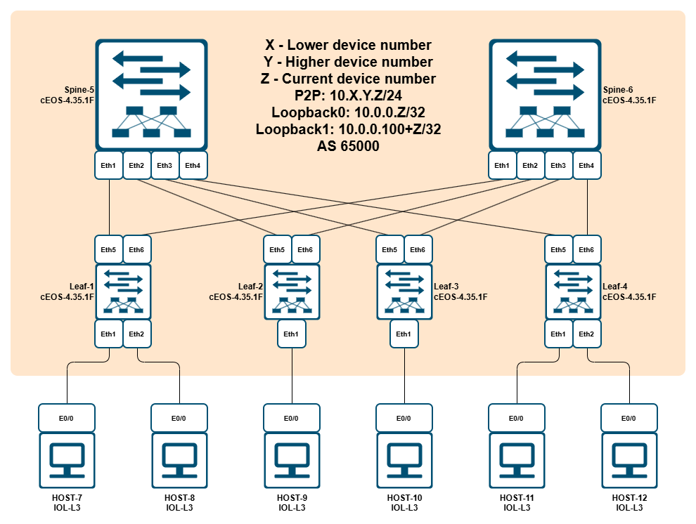
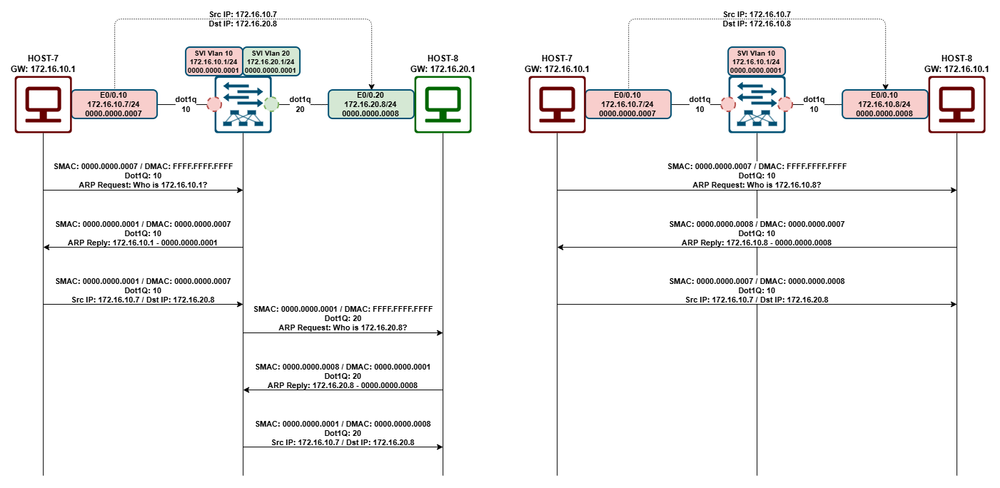
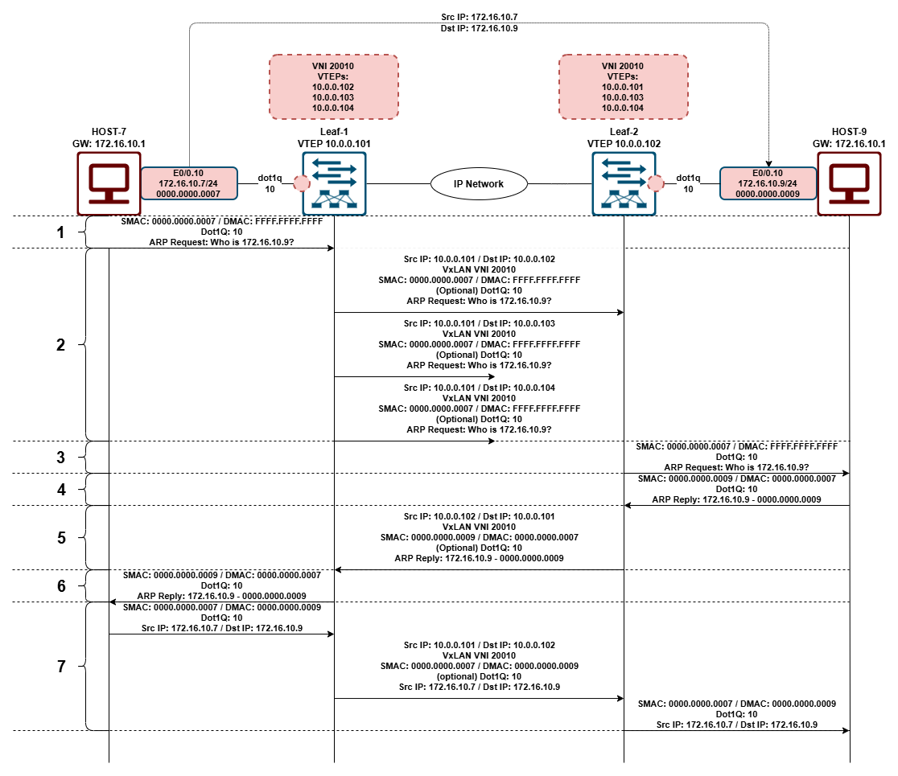
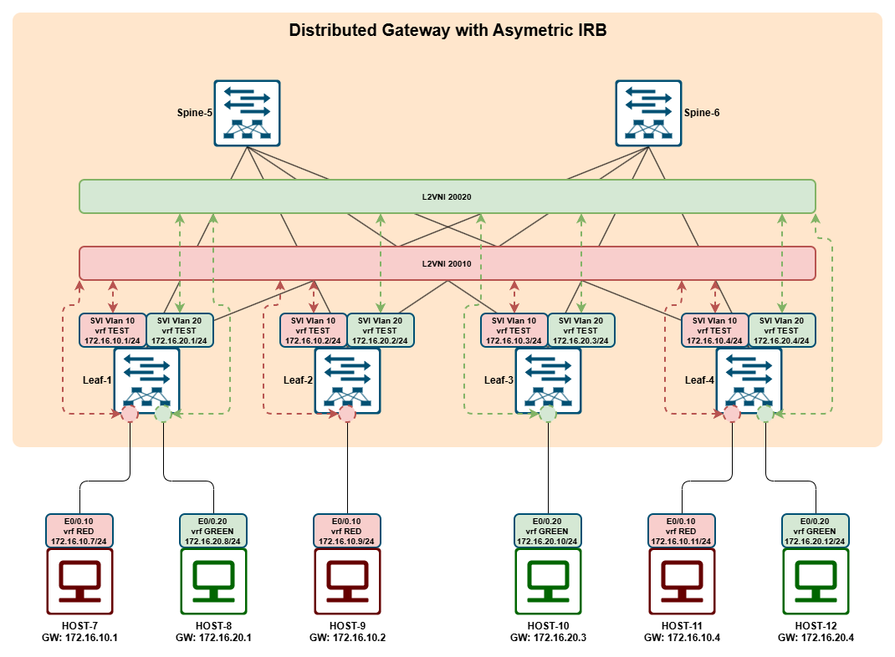

# EVPN VxLAN - варианты организации IRB-интерфейсов

- [EVPN VxLAN - варианты организации IRB-интерфейсов](#evpn-vxlan---варианты-организации-irb-интерфейсов)
  - [Топология](#топология)
  - [Symmetric / Asymmetric IRB](#symmetric--asymmetric-irb)
  - [Distributed Gateway with Asymmetric IRB](#distributed-gateway-with-asymmetric-irb)

В общем и целом, для меня, как не особо сталкивавшегося в работе с EVPN и VxLAN, было неочевидно, что это за звери такие: Centralized/Distributed Gateway и Symmetric/Asymmetric IRB. Теперь, видимо, пришла пора разобраться.

Однако прежде чем начать, стоит вспомнить немного о терминологии:

- ***IRB-интерфейс*** - Integrated routing and bridging - это L3-интерфейс, подключенный к какой-либо бриджуемой сущности. Если грубо говорить, то это аналог SVI, только используемый на маршрутизаторах :).
- ***Tunnel*** - см. ***Тоннель***.
- ***VTEP*** - VxLAN Tunnel EndPoint - это, как видно из названия, конечная точка VxLAN-туннеля, на которой происходит инкапсуляция и декапсуляция трафика в этот самый VxLAN-туннель.
- ***VNI*** - VxLAN Network Identifier - идентификатор сервиса VxLAN.
- ***Тоннель*** - смотри ***Tunnel***.

## Топология

Разбор будет происходить на следующей топологии:



Используемые образы:

- Spine и Leaf: cEOS (`ceos:4.35.1F`)
- Hosts: IOL L3 (`i86bi_LinuxL3-AdvEnterpriseK9-M2_157_3_May_2018.bin`)

Базовая конфигурация находится [здесь](./base_configuration.md).

## Symmetric / Asymmetric IRB

Прежде чем начать разбираться, давайте вспомним как происходит прохождение пакета в нескольких разных ситуациях.

На иллюстрации ниже показан процесс inter-vlan routing'а



А на следующей - процесс передачи кадров в рамках VxLAN L2VPN:



На последней остановимся чуть подробней. На ней показан процесс отправки IP-пакета между HOST-7 и HOST-9:

1. HOST-7 сначала выпускает ARP-запрос, чтобы узнать MAC-адрес HOST-9.
2. Leaf-1, получив этот кадр, делает несколько вещей:
   1. Получив кадр, Leaf-1 добавляет MAC-адрес HOST-7 в FDB.
   2. Изученный MAC-адрес добавляется в BGP-Loc-RIB в семействе L2VPN EVPN и отправляется, в итоге, на остальные VTEP в виде EVPN-маршрута типа 2 (MAC-IP). Остальные VTEP-устройства, получив такой маршрут, добавляют в FDB MAC-адрес HOST-7, как известный за VxLAN-интерфейсом через VTEP 10.0.0.101.
   3. Полученный кадр инкапсулируется в VxLAN-пакет и реплицируется в сторону всех VTEP, от которых для VNI 20010 были получены EVPN-маршруты типа 3 (Inclusive Multicast).
3. Leaf-3, получив VxLAN-пакет, декапсулирует кадр и отправляет его во все интерфейсы, на которые добавлен влан 10.
4. HOST-9, получает ARP-запрос, обрабатывает его и отправляет ARP Reply со своим MAC-адресом юникастом на MAC-адрес HOST-7.
5. Leaf-3 получает ARP Reply и снова происходит несколько вещей:
   1. Leaf-3 добавляет в FDB MAC-адрес HOST-09.
   2. Изученный MAC-адрес добавляется в BGP-Loc-RIB в семействе L2VPN EVPN и отправляется, в итоге, на остальные VTEP в виде EVPN-маршрута типа 2 (MAC-IP). Остальные VTEP-устройства, получив такой маршрут, добавляют в FDB MAC-адрес HOST-9, как известный за VxLAN-интерфейсом через VTEP 10.0.0.103.
   3. Проверяет FDB и находит MAC-адрес HOST-7, который относится к VTEP 10.0.0.101. Полученный кадр инкапсулируется в VxLAN-пакет и отправляется в сторону Leaf-1.
6. На Leaf-1 полученный VxLAN-пакет декапсулируется, и полученный кадр передается согласно записям в FDB. В итоге его получает HOST-7.
7. HOST-7 отправляет юникастовый кадр с вложенным IP-пакетом. Leaf-1 инкапсулирует его в VxLAN-пакет и отправляет в сторону Leaf-2. Тот же, в свою очередь, декапсулирует его и отправляет в сторону HOST-9.

## Distributed Gateway with Asymmetric IRB



В первую очередь выключим на Spine-6 все интерфейсы, чтобы позже было проще отслеживать пакеты.

**Spine-6:**

```arista
interface Ethernet1-4
 shutdown
!
```

Создадим на всех Leaf вланы, добавим их согласно схемы и создадим SVI.

Стоит отметить, что не всегда все вланы будут прописаны на портах, и, стало быть, SVI могут быть неактивны. Это, в свою очередь, может привести к проблемам маршрутизации у хостов, подключенных к такому Leaf. Чтобы решить эту проблему необходимо применить инструкцию `no autostate`, которая приведет к тому, что SVI будет всегда находится в состоянии `up`.

Также нужно обратить внимание на то, что для vrf TEST нужно в явном виде включить возможность маршрутизации - это особенность Arista.

**Leaf-1:**

```arista
vlan 10,20
!
vrf instance TEST
!
interface Ethernet1
   switchport trunk allowed vlan 10
   switchport mode trunk
!
interface Ethernet2
   switchport trunk allowed vlan 20
   switchport mode trunk
!
interface Vlan10
   no autostate
   vrf TEST
   ip address 172.16.10.1/24
!
interface Vlan20
   no autostate
   vrf TEST
   ip address 172.16.20.1/24
!
ip routing vrf TEST
!
```

**Leaf-2:**

```arista
vlan 10,20
!
vrf instance TEST
!
interface Ethernet1
   switchport trunk allowed vlan 10
   switchport mode trunk
!
interface Vlan10
   no autostate
   vrf TEST
   ip address 172.16.10.1/24
!
interface Vlan20
   no autostate
   vrf TEST
   ip address 172.16.20.1/24
!
ip routing vrf TEST
!
```

**Leaf-3:**

```arista
vlan 10,20
!
vrf instance TEST
!
interface Ethernet1
   switchport trunk allowed vlan 20
   switchport mode trunk
!
interface Vlan10
   no autostate
   vrf TEST
   ip address 172.16.10.3/24
!
interface Vlan20
   no autostate
   vrf TEST
   ip address 172.16.20.3/24
!
ip routing vrf TEST
!
```

**Leaf-4:**

```arista
vlan 10,20
!
vrf instance TEST
!
interface Ethernet1
   switchport trunk allowed vlan 10
   switchport mode trunk
!
interface Ethernet2
   switchport trunk allowed vlan 20
   switchport mode trunk
!
interface Vlan10
   no autostate
   vrf TEST
   ip address 172.16.10.4/24
!
interface Vlan20
   no autostate
   vrf TEST
   ip address 172.16.20.4/24
!
ip routing vrf TEST
!
```

Создадим NVE-интерфейс на каждом Leaf. В качестве источника будем использовать Loopback1.

**Leaf-1 / Leaf-2 / Leaf-3 / Leaf-4:**

```wbos
interface Vxlan1
   vxlan source-interface Loopback1
   vxlan udp-port 4789
```

Теперь настроим оба VNI: 20010 и 20020.

**Leaf-1 / Leaf-2 / Leaf-3 / Leaf-4:**

```wbos
interface Vxlan1
   vxlan vlan 10 vni 20010
   vxlan vlan 20 vni 20020
!
router bgp 65000
   vlan 10
      rd auto
      route-target both 65000:20010
   !
   vlan 20
      rd auto
      route-target both 65000:20020
   !
```

Проверим на Leaf-1 BGP-Loc-RIB:

**Leaf-1:**

```arista
Leaf-1#show bgp evpn 
BGP routing table information for VRF default
Router identifier 10.0.0.1, local AS number 65000
Route status codes: * - valid, > - active, S - Stale, E - ECMP head, e - ECMP
                    c - Contributing to ECMP, % - Pending best path selection
Origin codes: i - IGP, e - EGP, ? - incomplete
AS Path Attributes: Or-ID - Originator ID, C-LST - Cluster List, LL Nexthop - Link Local Nexthop

          Network                Next Hop              Metric  LocPref Weight  Path
 * >      RD: 10.0.0.1:10 imet 10.0.0.101
                                 -                     -       -       0       i
 * >      RD: 10.0.0.1:20 imet 10.0.0.101
                                 -                     -       -       0       i
 * >      RD: 10.0.0.2:10 imet 10.0.0.102
                                 10.0.0.102            -       100     0       i Or-ID: 10.0.0.2 C-LST: 10.0.0.5 
 * >      RD: 10.0.0.2:20 imet 10.0.0.102
                                 10.0.0.102            -       100     0       i Or-ID: 10.0.0.2 C-LST: 10.0.0.5 
 * >      RD: 10.0.0.3:10 imet 10.0.0.103
                                 10.0.0.103            -       100     0       i Or-ID: 10.0.0.3 C-LST: 10.0.0.5 
 * >      RD: 10.0.0.3:20 imet 10.0.0.103
                                 10.0.0.103            -       100     0       i Or-ID: 10.0.0.3 C-LST: 10.0.0.5 
 * >      RD: 10.0.0.4:10 imet 10.0.0.104
                                 10.0.0.104            -       100     0       i Or-ID: 10.0.0.4 C-LST: 10.0.0.5 
 * >      RD: 10.0.0.4:20 imet 10.0.0.104
                                 10.0.0.104            -       100     0       i Or-ID: 10.0.0.4 C-LST: 10.0.0.5 
Leaf-1#
```

Теперь на HOST-7 и HOST-9 создадим сабинтерфейс:

**HOST-7:**

```cisco
vrf definition RED
 !
 address-family ipv4
 exit-address-family
!
interface Ethernet0/0.10
 encapsulation dot1Q 10
 vrf forwarding RED
 ip address 172.16.10.7 255.255.255.0
!
ip route vrf RED 0.0.0.0 0.0.0.0 172.16.10.1
```

**HOST-9:**

```cisco
vrf definition RED
 !
 address-family ipv4
 exit-address-family
!
interface Ethernet0/0.10
 encapsulation dot1Q 10
 vrf forwarding RED
 ip address 172.16.10.9 255.255.255.0
!
ip route vrf RED 0.0.0.0 0.0.0.0 172.16.10.2
```

Включим захват трафика на Leaf-1, Ethernet5 и запустим пинг с HOST-7 на HOST-9.

**HOST-7:**

```wbos
HOST-7#ping vrf RED 172.16.10.9 repeat 3
Type escape sequence to abort.
Sending 3, 100-byte ICMP Echos to 172.16.10.9, timeout is 2 seconds:
.!!
Success rate is 66 percent (2/3), round-trip min/avg/max = 1/1/2 ms
HOST-7#
```

Как видно, пинг прошел. Теперь проверим FDB и BGP-Loc-RIB на Leaf-1:

**Leaf-1:**

```arista
Leaf-1#show mac address-table vlan 10
          Mac Address Table
------------------------------------------------------------------

Vlan    Mac Address       Type        Ports      Moves   Last Move
----    -----------       ----        -----      -----   ---------
  10    0000.0000.0007    DYNAMIC     Et1        1       0:00:30 ago
  10    0000.0000.0009    DYNAMIC     Vx1        1       0:00:30 ago
Total Mac Addresses for this criterion: 2

          Multicast Mac Address Table
------------------------------------------------------------------

Vlan    Mac Address       Type        Ports
----    -----------       ----        -----
Total Mac Addresses for this criterion: 0
Leaf-1#show bgp evpn vni 20010
BGP routing table information for VRF default
Router identifier 10.0.0.1, local AS number 65000
Route status codes: * - valid, > - active, S - Stale, E - ECMP head, e - ECMP
                    c - Contributing to ECMP, % - Pending best path selection
Origin codes: i - IGP, e - EGP, ? - incomplete
AS Path Attributes: Or-ID - Originator ID, C-LST - Cluster List, LL Nexthop - Link Local Nexthop

          Network                Next Hop              Metric  LocPref Weight  Path
 * >      RD: 10.0.0.1:10 mac-ip 0000.0000.0007
                                 -                     -       -       0       i
 * >      RD: 10.0.0.1:10 mac-ip 0000.0000.0007 172.16.10.7
                                 -                     -       -       0       i
 * >      RD: 10.0.0.2:10 mac-ip 0000.0000.0009
                                 10.0.0.102            -       100     0       i Or-ID: 10.0.0.2 C-LST: 10.0.0.5 
 * >      RD: 10.0.0.2:10 mac-ip 0000.0000.0009 172.16.10.9
                                 10.0.0.102            -       100     0       i Or-ID: 10.0.0.2 C-LST: 10.0.0.5 
 * >      RD: 10.0.0.1:10 imet 10.0.0.101
                                 -                     -       -       0       i
 * >      RD: 10.0.0.2:10 imet 10.0.0.102
                                 10.0.0.102            -       100     0       i Or-ID: 10.0.0.2 C-LST: 10.0.0.5 
 * >      RD: 10.0.0.3:10 imet 10.0.0.103
                                 10.0.0.103            -       100     0       i Or-ID: 10.0.0.3 C-LST: 10.0.0.5 
 * >      RD: 10.0.0.4:10 imet 10.0.0.104
                                 10.0.0.104            -       100     0       i Or-ID: 10.0.0.4 C-LST: 10.0.0.5 
Leaf-1#show arp vrf TEST
Legend:
 not learned: Associated MAC address is not present in the MAC address table
 -: Static (configuration or programmed by feature)
Address         Age (sec)  Hardware Addr   Interface
172.16.10.7       0:18:48  0000.0000.0007  Vlan10, Ethernet1
172.16.10.9             -  0000.0000.0009  Vlan10, Vxlan1
Leaf-1#
```

Как видно, в BGP-Loc-RIB появилось 4 новых маршрута типа 2: по 2 на каждый хост, один из них только с MAC-адресом, второй - со связкой MAC+IP. Второй маршрут появился из-за наличия SVI. Кстати, стоит обратить внимание на то, что и в arp-кэше появилась соответствующая запись.
